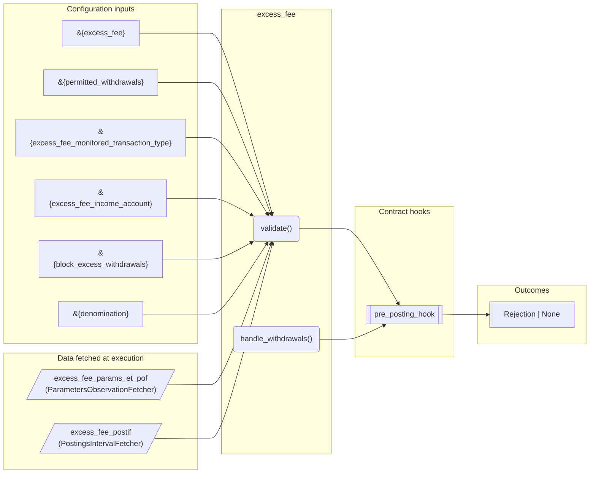
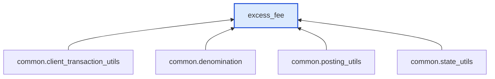

# Excess Fee

> Generated by `python3 -m fl docs`. Curated prose comes from `feature_library/src/feature_library/deposit/fees/withdrawal/excess_fee.okf.yaml`; everything else is derived from the module source. Do not edit by hand.

| Property | Value |
|---|---|
| Module | `feature_library.deposit.fees.withdrawal.excess_fee` |
| Domain | deposit |
| Status | undeclared |
| Version | — |
| Hooks | `pre_posting_hook` |
| Source | `feature_library/src/feature_library/deposit/fees/withdrawal/excess_fee.py` |

## What it does

_Not yet described._

## Traceability: configuration to outcome

Every input below is a value a bank configures. The diagram shows which function consumes it and which hook turns it into an outcome.

## Inputs — parameters

| Reference | Meaning | Hierarchy level | Constraint | Required | CLU resource |
|---|---|---|---|---|---|
| `&{excess_fee}` | Fee charged for every withdrawal that exceeds the monthly withdrawal limit. Triggers pre-parameter change hook? No.  Optional? No. | — | decimal_constraint | optional | `feature_library/src/feature_library/deposit/fees/withdrawal/parameter_resource_defs/excess_fee.resource.yaml` |
| `&{permitted_withdrawals}` | Number of monthly permitted withdrawals. Please note that only transactions with the specified transaction type are counted towards this excess fee. Triggers pre-parameter change hook? No.  Optional? No. | — | decimal_constraint | optional | `feature_library/src/feature_library/deposit/fees/withdrawal/parameter_resource_defs/permitted_withdrawals.resource.yaml` |
| `&{excess_fee_monitored_transaction_type}` | Transaction type being monitored to determine how many operations of this type occurred in the current calendar month period. This parameter will only be used for the assessment of the excessive withdrawal fee. Triggers pre-parameter change hook? No.  Optional? No. | — | string_constraint | optional | `feature_library/src/feature_library/deposit/fees/withdrawal/parameter_resource_defs/excess_fee_monitored_transaction_type.resource.yaml` |
| `&{excess_fee_income_account}` | Internal account for excess fee income balance. Triggers pre-parameter change hook? No.  Optional? No. | — | account_constraint | required | `feature_library/src/feature_library/deposit/fees/withdrawal/parameter_resource_defs/excess_fee_income_account.resource.yaml` |
| `&{block_excess_withdrawals}` | When configured, if the number of permitted withdrawals is exceeded, any subsequent withdrawals are blocked. If this is not configured, the withdrawal is accepted and the Excess Fee will be applied. Triggers pre-parameter change hook? No.  Optional? No. | — | enumeration_constraint | optional | `feature_library/src/feature_library/deposit/fees/withdrawal/parameter_resource_defs/block_excess_withdrawals.resource.yaml` |
| `&{denomination}` | _undocumented_ | — | string_constraint | required | `feature_library/src/feature_library/common/parameter_resource_defs/denomination.resource.yaml` |

## Inputs — data fetched at execution

| Fetcher id | Type | Anchor | Filter |
|---|---|---|---|
| `excess_fee_params_et_pof` | ParametersObservationFetcher | DefinedDateTime.EFFECTIVE_DATETIME | ParametersFilter(parameter_ids=[p.id for p in expected_parameters]) |
| `excess_fee_postif` | PostingsIntervalFetcher | RelativeDateTime(origin=DefinedDateTime.EFFECTIVE_DATETIME, shift=Shift(months=-1)) | — |

## Public API

| Function | Returns | Purpose |
|---|---|---|
| `get_parameters(vault, fetcher_id)` | `dict[str, datetime \| Decimal \| str \| None]` | Retrieves configuration parameters for the excess withdrawal fee feature. |
| `validate(state, proposed_client_transactions, fetchers_config)` | `Rejection \| None` | Checks the number of relevant withdrawals in the current month and rejects if the |
| `handle_withdrawals(state, proposed_client_transactions, fetchers_config, account_type)` | `list[CustomInstruction]` | Checks the number of relevant withdrawals in the current month and returns fee instructions |

## Where it sits in the library

## Requirement traceability

_No business requirement is linked to this feature yet, so it cannot be traced back to a stated need._

## Products using it

_None. A feature that no product composes is not yet a proven building block._

## Testing

| Tier | Status | Test modules |
|---|---|---|
| Unit | **missing** | 0 |
| Simulation | yes | 1 |
| End-to-end | yes | 1 |

<!-- generated:end -->
