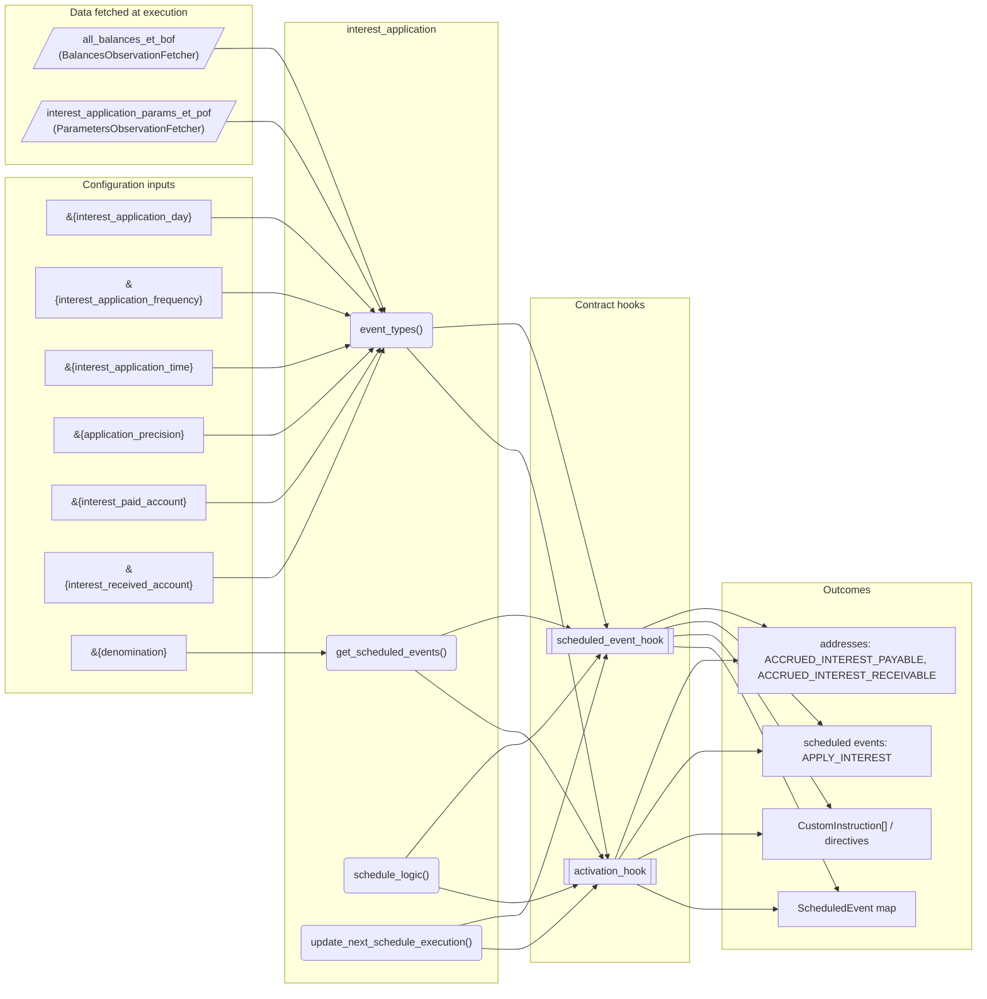

# Interest Application

> Generated by `python3 -m fl docs`. Curated prose comes from `feature_library/src/feature_library/deposit/interest/interest_application.okf.yaml`; everything else is derived from the module source. Do not edit by hand.

| Property | Value |
|---|---|
| Module | `feature_library.deposit.interest.interest_application` |
| Domain | deposit |
| Status | undeclared |
| Version | — |
| Hooks | `activation_hook`, `scheduled_event_hook` |
| Source | `feature_library/src/feature_library/deposit/interest/interest_application.py` |

## What it does

_Not yet described._

## Traceability: configuration to outcome

Every input below is a value a bank configures. The diagram shows which function consumes it and which hook turns it into an outcome.

## Inputs — parameters

| Reference | Meaning | Hierarchy level | Constraint | Required | CLU resource |
|---|---|---|---|---|---|
| `&{interest_application_day}` | _undocumented_ | — | decimal_constraint | required | `feature_library/src/feature_library/deposit/interest/parameter_resource_defs/interest_application_day.resource.yaml` |
| `&{interest_application_frequency}` | _undocumented_ | — | enumeration_constraint | required | `feature_library/src/feature_library/deposit/interest/parameter_resource_defs/interest_application_frequency.resource.yaml` |
| `&{interest_application_time}` | _undocumented_ | — | string_constraint | required | `feature_library/src/feature_library/deposit/interest/parameter_resource_defs/interest_application_time.resource.yaml` |
| `&{application_precision}` | _undocumented_ | — | decimal_constraint | required | `feature_library/src/feature_library/common/parameter_resource_defs/application_precision.resource.yaml` |
| `&{interest_paid_account}` | _undocumented_ | — | account_constraint | required | `feature_library/src/feature_library/deposit/interest/parameter_resource_defs/interest_paid_account.resource.yaml` |
| `&{interest_received_account}` | _undocumented_ | — | account_constraint | required | `feature_library/src/feature_library/deposit/interest/parameter_resource_defs/interest_received_account.resource.yaml` |
| `&{denomination}` | _undocumented_ | — | string_constraint | required | `feature_library/src/feature_library/common/parameter_resource_defs/denomination.resource.yaml` |

## Inputs — data fetched at execution

| Fetcher id | Type | Anchor | Filter |
|---|---|---|---|
| `all_balances_et_bof` | BalancesObservationFetcher | DefinedDateTime.EFFECTIVE_DATETIME | — |
| `interest_application_params_et_pof` | ParametersObservationFetcher | DefinedDateTime.EFFECTIVE_DATETIME | ParametersFilter(parameter_ids=[p.id for p in expected_parameters]) |

## Public API

| Function | Returns | Purpose |
|---|---|---|
| `event_types(product_name)` | `list[SmartContractEventType]` | Returns a list of SmartContractEventTypes for the interest application feature. |
| `get_parameters(vault, param_fetcher_id)` | `dict[str, datetime \| Decimal \| str \| None]` | Retrieves parameters for the interest application feature from the vault. |
| `get_scheduled_events(state, reference_datetime, fetchers_config)` | `dict[str, ScheduledEvent]` | Creates execution schedules for interest application. |
| `schedule_logic(state, account_type, application_fetchers_config, accrual_fetchers_config, interest_types)` | `common_tuples.ScheduleLogicResult` | Creates the posting instructions to consolidate accrued interest. |
| `update_next_schedule_execution(state)` | `UpdateAccountEventTypeDirective \| None` | Update next scheduled execution. |

## Outputs

| Kind | Values | Notes |
|---|---|---|
| Scheduled events | `APPLY_INTEREST` | per-product factory |
| Balance addresses | `ACCRUED_INTEREST_PAYABLE`, `ACCRUED_INTEREST_RECEIVABLE` | — |

## Where it sits in the library

```mermaid
graph BT
  me_interest_application["interest_application"]:::self
  dep_common_accrual_utils["common.accrual_utils"] --> me_interest_application
  dep_common_balance_utils["common.balance_utils"] --> me_interest_application
  dep_common_denomination["common.denomination"] --> me_interest_application
  dep_common_fetchers["common.fetchers"] --> me_interest_application
  dep_common_posting_utils["common.posting_utils"] --> me_interest_application
  dep_common_schedule_utils["common.schedule_utils"] --> me_interest_application
  dep_common_state_utils["common.state_utils"] --> me_interest_application
  dep_common_tuples["common.tuples"] --> me_interest_application
  dep_common_utils["common.utils"] --> me_interest_application
  dep_deposit_addresses["deposit.addresses"] --> me_interest_application
  dep_deposit_interest_interest_accrual["deposit.interest.interest_accrual"] --> me_interest_application
  me_interest_application ==> prod_corporate_current_account["corporate_current_account"]:::product
  me_interest_application ==> prod_personal_current_account["personal_current_account"]:::product
  classDef self fill:#dbeafe,stroke:#1d4ed8,stroke-width:2px;
  classDef product fill:#dcfce7,stroke:#15803d,stroke-width:2px;
```

## Requirement traceability

_No business requirement is linked to this feature yet, so it cannot be traced back to a stated need._

## Products using it

- `corporate_current_account`
- `personal_current_account`

## Testing

| Tier | Status | Test modules |
|---|---|---|
| Unit | yes | 1 |
| Simulation | yes | 1 |
| End-to-end | yes | 1 |

<!-- generated:end -->
