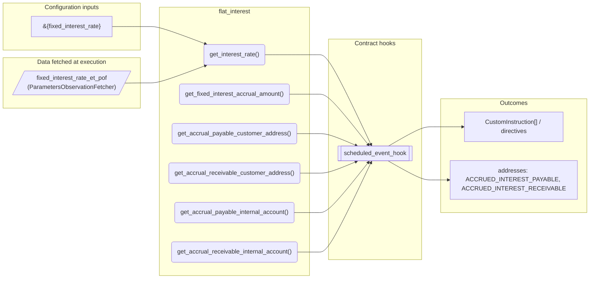
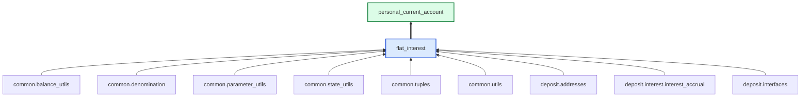

# Flat Interest

> Generated by `python3 -m fl docs`. Curated prose comes from `feature_library/src/feature_library/deposit/interest/secondary/flat_interest.okf.yaml`; everything else is derived from the module source. Do not edit by hand.

| Property | Value |
|---|---|
| Module | `feature_library.deposit.interest.secondary.flat_interest` |
| Domain | deposit |
| Status | undeclared |
| Version | — |
| Hooks | — |
| Source | `feature_library/src/feature_library/deposit/interest/secondary/flat_interest.py` |

## What it does

Flat interest rate feature module for deposit accounts.

## Traceability: configuration to outcome

Every input below is a value a bank configures. The diagram shows which function consumes it and which hook turns it into an outcome.

## Inputs — parameters

| Reference | Meaning | Hierarchy level | Constraint | Required | CLU resource |
|---|---|---|---|---|---|
| `&{fixed_interest_rate}` | _undocumented_ | — | decimal_constraint | required | `feature_library/src/feature_library/deposit/interest/parameter_resource_defs/fixed_interest_rate.resource.yaml` |

## Inputs — data fetched at execution

| Fetcher id | Type | Anchor | Filter |
|---|---|---|---|
| `fixed_interest_rate_et_pof` | ParametersObservationFetcher | DefinedDateTime.EFFECTIVE_DATETIME | ParametersFilter(parameter_ids=[FIXED_INTEREST_RATE_PARAM_ID]) |

## Public API

| Function | Returns | Purpose |
|---|---|---|
| `get_parameters(vault, param_fetcher_id)` | `dict[str, datetime \| Decimal \| str \| None]` | Get required parameters for fixed interest from fetcher. |
| `get_interest_rate(state, fetchers_config)` | `common_tuples.InterestRateTuple` | Get interest rate from state. |
| `get_fixed_interest_accrual_amount(effective_balance, effective_datetime, interest_rates, days_in_year, precision, state, fetchers_config)` | `common_tuples.AccrualDetail` | Calculates fixed interest accrual amount. |
| `get_accrual_payable_customer_address()` | `str` | Returns the customer account address where payable interest is accrued. |
| `get_accrual_receivable_customer_address()` | `str` | Returns the customer account address where receivable interest is accrued. |
| `get_accrual_payable_internal_account(state)` | `str` | Returns the internal account where payable interest is accrued. |
| `get_accrual_receivable_internal_account(state)` | `str` | Returns the internal account where receivable interest is accrued. |

## Outputs

| Kind | Values | Notes |
|---|---|---|
| Balance addresses | `ACCRUED_INTEREST_PAYABLE`, `ACCRUED_INTEREST_RECEIVABLE` | — |

## Composition points

| Provides interface | As constant | Members |
|---|---|---|
| `InterestType` | `InterestType` | `get_interest_rate`, `get_accrual_amount`, `get_accrual_payable_customer_address`, `get_accrual_receivable_customer_address`, `get_accrual_payable_internal_account`, `get_accrual_receivable_internal_account` |

## Where it sits in the library

## Requirement traceability

_No business requirement is linked to this feature yet, so it cannot be traced back to a stated need._

## Products using it

- `personal_current_account`

## Testing

| Tier | Status | Test modules |
|---|---|---|
| Unit | yes | 1 |
| Simulation | yes | 2 |
| End-to-end | yes | 1 |

<!-- generated:end -->
