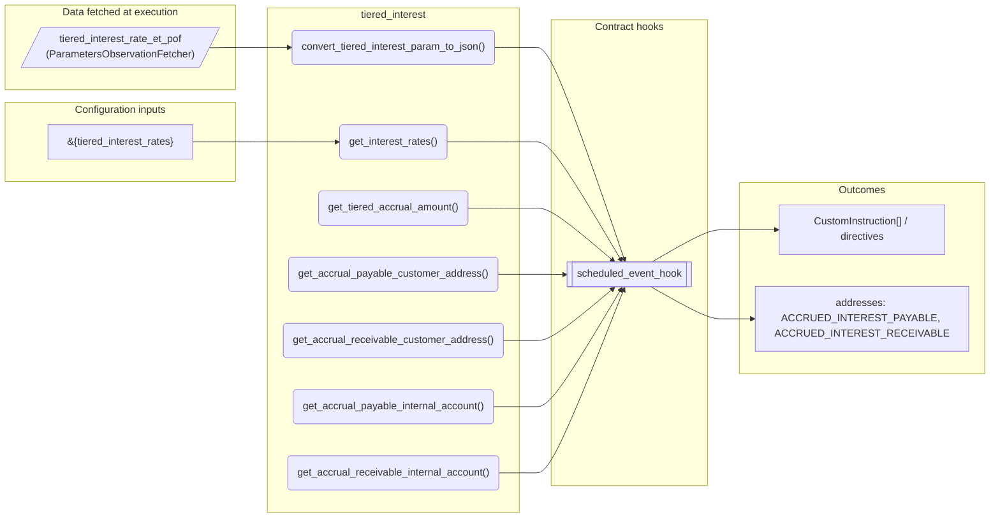

# Tiered Interest

> Generated by `python3 -m fl docs`. Curated prose comes from `feature_library/src/feature_library/deposit/interest/secondary/tiered_interest.okf.yaml`; everything else is derived from the module source. Do not edit by hand.

| Property | Value |
|---|---|
| Module | `feature_library.deposit.interest.secondary.tiered_interest` |
| Domain | deposit |
| Status | undeclared |
| Version | — |
| Hooks | — |
| Source | `feature_library/src/feature_library/deposit/interest/secondary/tiered_interest.py` |

## What it does

Tiered interest rate feature module for deposit accounts.

## Traceability: configuration to outcome

Every input below is a value a bank configures. The diagram shows which function consumes it and which hook turns it into an outcome.

## Inputs — parameters

| Reference | Meaning | Hierarchy level | Constraint | Required | CLU resource |
|---|---|---|---|---|---|
| `&{tiered_interest_rates}` | _undocumented_ | — | string_constraint | required | `feature_library/src/feature_library/deposit/interest/parameter_resource_defs/tiered_interest_rates.resource.yaml` |

## Inputs — data fetched at execution

| Fetcher id | Type | Anchor | Filter |
|---|---|---|---|
| `tiered_interest_rate_et_pof` | ParametersObservationFetcher | DefinedDateTime.EFFECTIVE_DATETIME | ParametersFilter(parameter_ids=[TIERED_INTEREST_RATES_PARAM_ID]) |

## Public API

| Function | Returns | Purpose |
|---|---|---|
| `get_parameters(vault, param_fetcher_id)` | `dict[str, datetime \| Decimal \| str \| None]` | Get required parameters for tiered interest from fetcher. |
| `convert_tiered_interest_param_to_json(param_value)` | `dict[str, str]` | Converts a tiered interest parameter string into a JSON dictionary. |
| `get_interest_rates(state, fetchers_config)` | `common_tuples.InterestRateTuple` | Get interest rates from state. |
| `get_tiered_accrual_amount(effective_balance, effective_datetime, interest_rates, days_in_year, precision, state, fetchers_config)` | `common_tuples.AccrualDetail` | Calculate tiered interest accrual. |
| `get_accrual_payable_customer_address()` | `str` | Returns the customer account address where payable interest is accrued. |
| `get_accrual_receivable_customer_address()` | `str` | Returns the customer account address where receivable interest is accrued. |
| `get_accrual_payable_internal_account(state)` | `str` | Returns the internal account where payable interest is accrued. |
| `get_accrual_receivable_internal_account(state)` | `str` | Returns the internal account where receivable interest is accrued. |

## Outputs

| Kind | Values | Notes |
|---|---|---|
| Balance addresses | `ACCRUED_INTEREST_PAYABLE`, `ACCRUED_INTEREST_RECEIVABLE` | — |

## Composition points

| Provides interface | As constant | Members |
|---|---|---|
| `InterestType` | `InterestType` | `get_interest_rate`, `get_accrual_amount`, `get_accrual_payable_customer_address`, `get_accrual_receivable_customer_address`, `get_accrual_payable_internal_account`, `get_accrual_receivable_internal_account` |

## Where it sits in the library

```mermaid
graph BT
  me_tiered_interest["tiered_interest"]:::self
  dep_common_balance_utils["common.balance_utils"] --> me_tiered_interest
  dep_common_denomination["common.denomination"] --> me_tiered_interest
  dep_common_parameter_utils["common.parameter_utils"] --> me_tiered_interest
  dep_common_state_utils["common.state_utils"] --> me_tiered_interest
  dep_common_tuples["common.tuples"] --> me_tiered_interest
  dep_common_utils["common.utils"] --> me_tiered_interest
  dep_deposit_addresses["deposit.addresses"] --> me_tiered_interest
  dep_deposit_interest_deposit_interest_accrual_utils["deposit.interest.deposit_interest_accrual_utils"] --> me_tiered_interest
  dep_deposit_interest_interest_accrual["deposit.interest.interest_accrual"] --> me_tiered_interest
  dep_deposit_interfaces["deposit.interfaces"] --> me_tiered_interest
  me_tiered_interest ==> prod_corporate_current_account["corporate_current_account"]:::product
  classDef self fill:#dbeafe,stroke:#1d4ed8,stroke-width:2px;
  classDef product fill:#dcfce7,stroke:#15803d,stroke-width:2px;
```

## Requirement traceability

_No business requirement is linked to this feature yet, so it cannot be traced back to a stated need._

## Products using it

- `corporate_current_account`

## Testing

| Tier | Status | Test modules |
|---|---|---|
| Unit | yes | 1 |
| Simulation | yes | 1 |
| End-to-end | **missing** | 0 |

<!-- generated:end -->
