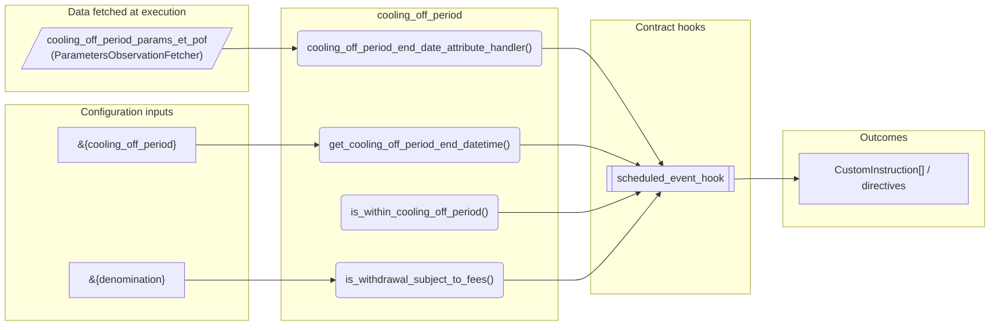
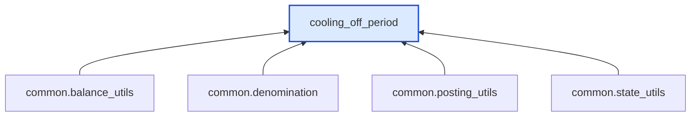

# Cooling Off Period

> Generated by `python3 -m fl docs`. Curated prose comes from `feature_library/src/feature_library/deposit/temporal_features/cooling_off_period.okf.yaml`; everything else is derived from the module source. Do not edit by hand.

| Property | Value |
|---|---|
| Module | `feature_library.deposit.temporal_features.cooling_off_period` |
| Domain | deposit |
| Status | undeclared |
| Version | — |
| Hooks | — |
| Source | `feature_library/src/feature_library/deposit/temporal_features/cooling_off_period.py` |

## What it does

_Not yet described._

## Traceability: configuration to outcome

Every input below is a value a bank configures. The diagram shows which function consumes it and which hook turns it into an outcome.

## Inputs — parameters

| Reference | Meaning | Hierarchy level | Constraint | Required | CLU resource |
|---|---|---|---|---|---|
| `&{cooling_off_period}` | The number of days from the account activation datetime when a user can make a full withdrawal without incurring any fees. | — | decimal_constraint | required | `feature_library/src/feature_library/deposit/temporal_features/parameter_resource_defs/cooling_off_period.resource.yaml` |
| `&{denomination}` | _undocumented_ | — | string_constraint | required | `feature_library/src/feature_library/common/parameter_resource_defs/denomination.resource.yaml` |

## Inputs — data fetched at execution

| Fetcher id | Type | Anchor | Filter |
|---|---|---|---|
| `cooling_off_period_params_et_pof` | ParametersObservationFetcher | DefinedDateTime.EFFECTIVE_DATETIME | ParametersFilter(parameter_ids=[p.id for p in expected_parameters]) |

## Public API

| Function | Returns | Purpose |
|---|---|---|
| `get_parameters(vault, fetcher_id)` | `dict[str, Any]` | Retrieves feature-specific parameters from the vault. |
| `cooling_off_period_end_date_attribute_handler(vault, hook_arguments, fetchers_config)` | `AttributeHookResult` | Gets the cooling-off period end date for the attribute hook. |
| `get_cooling_off_period_end_datetime(state, fetchers_config)` | `datetime` | Calculates and returns the cooling-off period end datetime. |
| `is_within_cooling_off_period(state, fetchers_config)` | `bool` | Determines whether the effective datetime is within the cooling-off period of an account. |
| `is_withdrawal_subject_to_fees(state, posting_instructions, fetchers_config)` | `bool` | Determine if a withdrawal is subject to fees. |

## Where it sits in the library

## Requirement traceability

_No business requirement is linked to this feature yet, so it cannot be traced back to a stated need._

## Products using it

_None. A feature that no product composes is not yet a proven building block._

## Testing

| Tier | Status | Test modules |
|---|---|---|
| Unit | yes | 1 |
| Simulation | yes | 1 |
| End-to-end | yes | 1 |

<!-- generated:end -->
