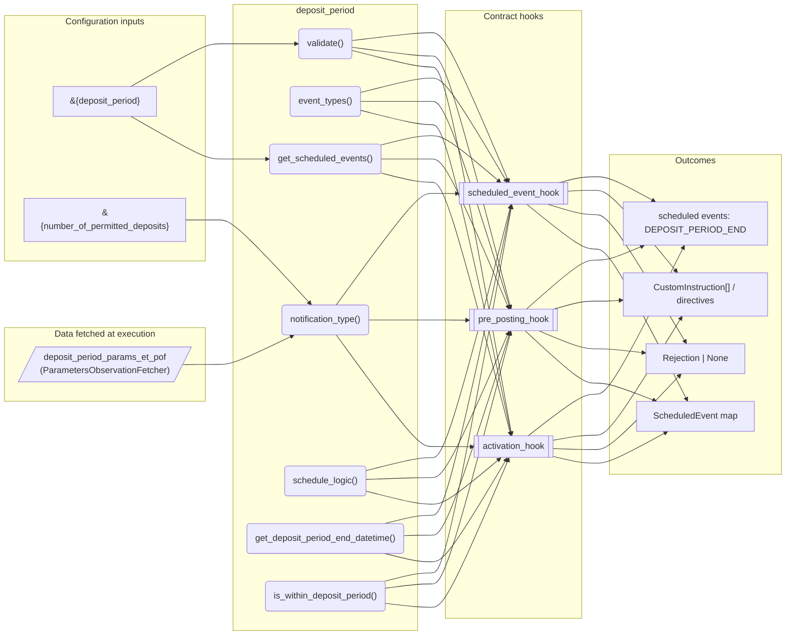
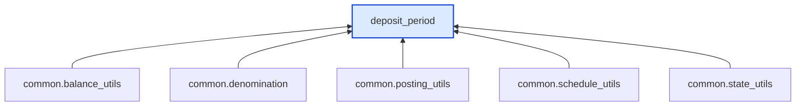

# Deposit Period

> Generated by `python3 -m fl docs`. Curated prose comes from `feature_library/src/feature_library/deposit/temporal_features/deposit_period.okf.yaml`; everything else is derived from the module source. Do not edit by hand.

| Property | Value |
|---|---|
| Module | `feature_library.deposit.temporal_features.deposit_period` |
| Domain | deposit |
| Status | undeclared |
| Version | — |
| Hooks | `activation_hook`, `pre_posting_hook`, `scheduled_event_hook` |
| Source | `feature_library/src/feature_library/deposit/temporal_features/deposit_period.py` |

## What it does

_Not yet described._

## Traceability: configuration to outcome

Every input below is a value a bank configures. The diagram shows which function consumes it and which hook turns it into an outcome.

## Inputs — parameters

| Reference | Meaning | Hierarchy level | Constraint | Required | CLU resource |
|---|---|---|---|---|---|
| `&{deposit_period}` | _undocumented_ | — | decimal_constraint | required | `feature_library/src/feature_library/deposit/temporal_features/parameter_resource_defs/deposit_period.resource.yaml` |
| `&{number_of_permitted_deposits}` | _undocumented_ | — | enumeration_constraint | required | `feature_library/src/feature_library/deposit/temporal_features/parameter_resource_defs/number_of_permitted_deposits.resource.yaml` |

## Inputs — data fetched at execution

| Fetcher id | Type | Anchor | Filter |
|---|---|---|---|
| `deposit_period_params_et_pof` | ParametersObservationFetcher | DefinedDateTime.EFFECTIVE_DATETIME | ParametersFilter(parameter_ids=[DEPOSIT_PERIOD_PARAM_ID, NUMBER_OF_PERMITTED_DEP |

## Public API

| Function | Returns | Purpose |
|---|---|---|
| `get_parameters(vault, fetcher_id)` | `dict[str, str \| datetime \| Decimal \| None]` | Retrieves feature-specific parameters from the vault. |
| `notification_type(product_name)` | `str` | Returns a notification type. |
| `event_types(product_name)` | `list[SmartContractEventType]` | Returns a list of event types for the feature. |
| `get_scheduled_events(state, fetchers_config)` | `dict[str, ScheduledEvent]` | Creates execution schedules for the deposit period end. |
| `validate(state, posting_instructions, fetchers_config)` | `Rejection \| None` | Validates proposed postings against the deposit period. |
| `schedule_logic(state, product_name, fetchers_config)` | `list[AccountNotificationDirective]` | Executes logic for the deposit period end schedule. |
| `get_deposit_period_end_datetime(state)` | `datetime` | Calculates and returns the deposit period end datetime. |
| `is_within_deposit_period(state)` | `bool` | Determines whether the effective datetime is within the deposit period. |

## Outputs

| Kind | Values | Notes |
|---|---|---|
| Scheduled events | `DEPOSIT_PERIOD_END` | per-product factory |

## Where it sits in the library

## Requirement traceability

_No business requirement is linked to this feature yet, so it cannot be traced back to a stated need._

## Products using it

_None. A feature that no product composes is not yet a proven building block._

## Testing

| Tier | Status | Test modules |
|---|---|---|
| Unit | yes | 1 |
| Simulation | yes | 1 |
| End-to-end | yes | 1 |

<!-- generated:end -->
