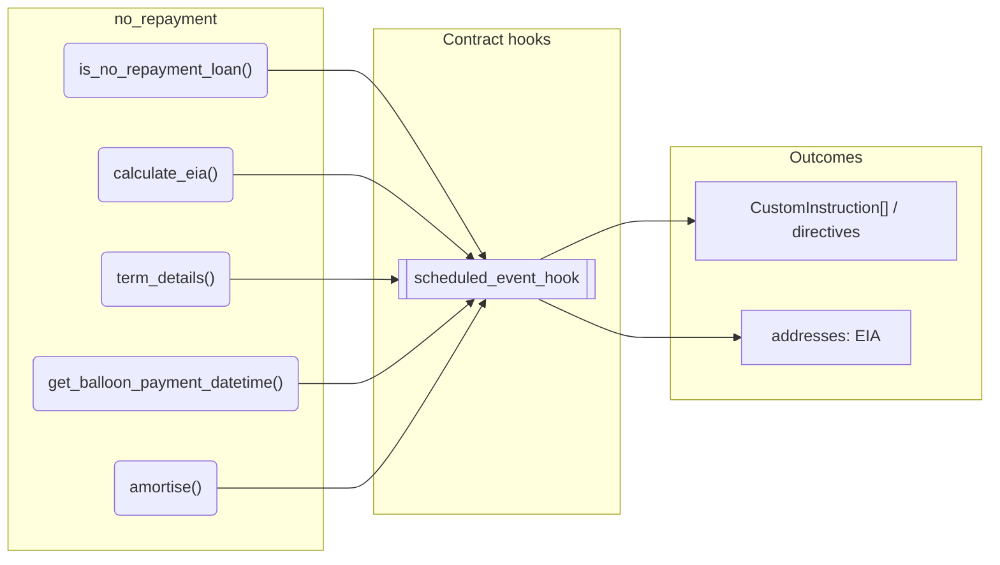
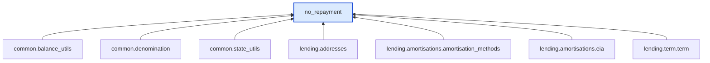

# No Repayment

> Generated by `python3 -m fl docs`. Curated prose comes from `feature_library/src/feature_library/lending/amortisations/amortisation_methods/no_repayment.okf.yaml`; everything else is derived from the module source. Do not edit by hand.

| Property | Value |
|---|---|
| Module | `feature_library.lending.amortisations.amortisation_methods.no_repayment` |
| Domain | lending |
| Status | undeclared |
| Version | — |
| Hooks | — |
| Source | `feature_library/src/feature_library/lending/amortisations/amortisation_methods/no_repayment.py` |

## What it does

No repayment feature.

## Traceability: configuration to outcome

Every input below is a value a bank configures. The diagram shows which function consumes it and which hook turns it into an outcome.

## Public API

| Function | Returns | Purpose |
|---|---|---|
| `is_no_repayment_loan(amortisation_method)` | `bool` | Returns True if the amortisation_method is 'NO_REPAYMENT'. |
| `calculate_eia()` | `Decimal` | Return 0 EIA for no repayment amortisation. |
| `term_details(state, fetchers_config)` | `TermDetails` | Calculate the elapsed and remaining term for a loan based on execution time. |
| `get_balloon_payment_datetime(state)` | `datetime` | Calculates the balloon payment datetime. |
| `amortise(state, event, eia_address, fetchers_config)` | `list[CustomInstruction]` | Amortise a loan by calculating EIA and creating a custom instruction. |

## Outputs

| Kind | Values | Notes |
|---|---|---|
| Balance addresses | `EIA` | — |

## Where it sits in the library

## Requirement traceability

_No business requirement is linked to this feature yet, so it cannot be traced back to a stated need._

## Products using it

_None. A feature that no product composes is not yet a proven building block._

## Testing

| Tier | Status | Test modules |
|---|---|---|
| Unit | yes | 1 |
| Simulation | **missing** | 0 |
| End-to-end | **missing** | 0 |

<!-- generated:end -->
