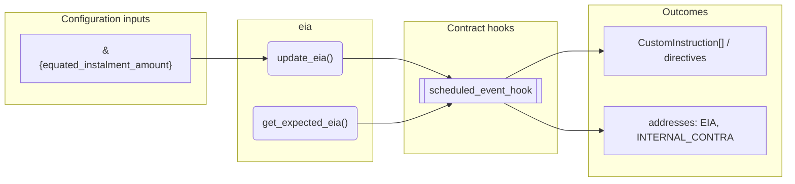

# Eia

> Generated by `python3 -m fl docs`. Curated prose comes from `feature_library/src/feature_library/lending/amortisations/eia.okf.yaml`; everything else is derived from the module source. Do not edit by hand.

| Property | Value |
|---|---|
| Module | `feature_library.lending.amortisations.eia` |
| Domain | lending |
| Status | undeclared |
| Version | — |
| Hooks | — |
| Source | `feature_library/src/feature_library/lending/amortisations/eia.py` |

## What it does

Eia feature.

## Traceability: configuration to outcome

Every input below is a value a bank configures. The diagram shows which function consumes it and which hook turns it into an outcome.

## Inputs — parameters

| Reference | Meaning | Hierarchy level | Constraint | Required | CLU resource |
|---|---|---|---|---|---|
| `&{equated_instalment_amount}` | _undocumented_ | — | decimal_constraint | optional | `feature_library/src/feature_library/lending/amortisations/parameter_resource_defs/equated_instalment_amount.resource.yaml` |

## Public API

| Function | Returns | Purpose |
|---|---|---|
| `update_eia(account_id, denomination, current_eia, updated_eia, eia_address, contra_address)` | `list[Posting]` | Create postings to update the EIA balance. |
| `get_expected_eia(state, eia_address, fetchers_config)` | `Decimal` | Retrieve the expected EIA from the account balances. |

## Outputs

| Kind | Values | Notes |
|---|---|---|
| Balance addresses | `EIA`, `INTERNAL_CONTRA` | — |

## Where it sits in the library

```mermaid
graph BT
  me_eia["eia"]:::self
  dep_common_addresses["common.addresses"] --> me_eia
  dep_common_application_precision["common.application_precision"] --> me_eia
  dep_common_balance_utils["common.balance_utils"] --> me_eia
  dep_common_denomination["common.denomination"] --> me_eia
  dep_common_posting_utils["common.posting_utils"] --> me_eia
  dep_common_state_utils["common.state_utils"] --> me_eia
  dep_common_utils["common.utils"] --> me_eia
  dep_lending_addresses["lending.addresses"] --> me_eia
  me_eia --> use_lending_amortisations_amortisation_methods_declining_pri["lending.amortisations.amortisation_methods.declining_principal"]
  me_eia --> use_lending_amortisations_amortisation_methods_flat_interest["lending.amortisations.amortisation_methods.flat_interest"]
  me_eia --> use_lending_amortisations_amortisation_methods_interest_only["lending.amortisations.amortisation_methods.interest_only"]
  me_eia --> use_lending_amortisations_amortisation_methods_minimum_repay["lending.amortisations.amortisation_methods.minimum_repayment"]
  me_eia --> use_lending_amortisations_amortisation_methods_no_repayment["lending.amortisations.amortisation_methods.no_repayment"]
  me_eia --> use_lending_amortisations_amortisation_methods_rule_of_78["lending.amortisations.amortisation_methods.rule_of_78"]
  me_eia ==> prod_mortgage["mortgage"]:::product
  classDef self fill:#dbeafe,stroke:#1d4ed8,stroke-width:2px;
  classDef product fill:#dcfce7,stroke:#15803d,stroke-width:2px;
```

## Requirement traceability

_No business requirement is linked to this feature yet, so it cannot be traced back to a stated need._

## Products using it

- `mortgage`

## Testing

| Tier | Status | Test modules |
|---|---|---|
| Unit | yes | 1 |
| Simulation | **missing** | 0 |
| End-to-end | **missing** | 0 |

<!-- generated:end -->
