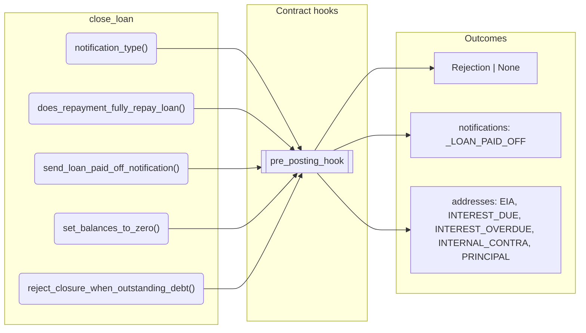
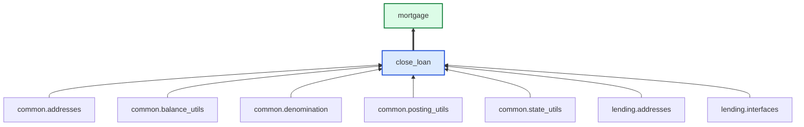

# Close Loan

> Generated by `python3 -m fl docs`. Curated prose comes from `feature_library/src/feature_library/lending/closure/close_loan.okf.yaml`; everything else is derived from the module source. Do not edit by hand.

| Property | Value |
|---|---|
| Module | `feature_library.lending.closure.close_loan` |
| Domain | lending |
| Status | undeclared |
| Version | — |
| Hooks | `pre_posting_hook` |
| Source | `feature_library/src/feature_library/lending/closure/close_loan.py` |

## What it does

_Not yet described._

## Traceability: configuration to outcome

Every input below is a value a bank configures. The diagram shows which function consumes it and which hook turns it into an outcome.

## Public API

| Function | Returns | Purpose |
|---|---|---|
| `notification_type(product_name)` | `str` | Creates the notification type for a paid off loan. |
| `does_repayment_fully_repay_loan(state, repayment_posting_instructions, repayment_hierarchy_config, fetchers_config)` | `bool` | Determines whether the repayment posting instructions fully repay the outstanding debt. |
| `send_loan_paid_off_notification(state, product_name)` | `AccountNotificationDirective` | Instruct a loan paid off notification. |
| `set_balances_to_zero(state, residual_cleanup_features, eia_address, internal_contra_address, fetchers_config)` | `list[CustomInstruction]` | Sets residual balances to zero by netting off the EIA and other accounting addresses. |
| `reject_closure_when_outstanding_debt(state, repayment_hierarchy_config)` | `Rejection \| None` | Returns a rejection if the debt addresses sum to a non-zero amount. |

## Outputs

| Kind | Values | Notes |
|---|---|---|
| Notifications | `_LOAN_PAID_OFF` | — |
| Balance addresses | `EIA`, `INTEREST_DUE`, `INTEREST_OVERDUE`, `INTERNAL_CONTRA`, `PRINCIPAL`, `PRINCIPAL_DUE`, `PRINCIPAL_OVERDUE` | — |

## Composition points

Accepts: `RepaymentHierarchyConfig`, `ResidualCleanup`

## Where it sits in the library

## Requirement traceability

_No business requirement is linked to this feature yet, so it cannot be traced back to a stated need._

## Products using it

- `mortgage`

## Testing

| Tier | Status | Test modules |
|---|---|---|
| Unit | yes | 1 |
| Simulation | yes | 1 |
| End-to-end | yes | 1 |

<!-- generated:end -->
