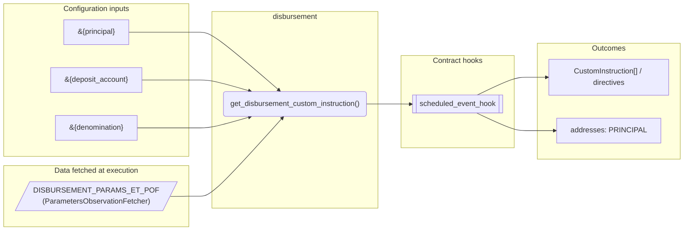
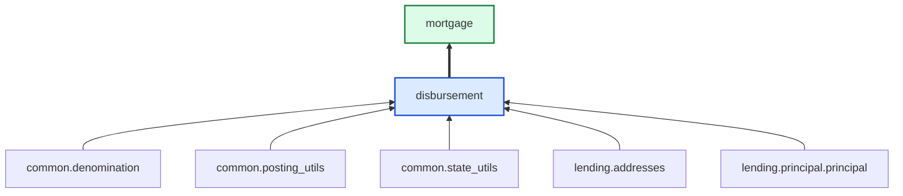

# Disbursement

> Generated by `python3 -m fl docs`. Curated prose comes from `feature_library/src/feature_library/lending/disbursal/disbursement.okf.yaml`; everything else is derived from the module source. Do not edit by hand.

| Property | Value |
|---|---|
| Module | `feature_library.lending.disbursal.disbursement` |
| Domain | lending |
| Status | undeclared |
| Version | — |
| Hooks | — |
| Source | `feature_library/src/feature_library/lending/disbursal/disbursement.py` |

## What it does

_Not yet described._

## Traceability: configuration to outcome

Every input below is a value a bank configures. The diagram shows which function consumes it and which hook turns it into an outcome.

## Inputs — parameters

| Reference | Meaning | Hierarchy level | Constraint | Required | CLU resource |
|---|---|---|---|---|---|
| `&{principal}` | _undocumented_ | — | decimal_constraint | required | `feature_library/src/feature_library/lending/principal/parameter_resource_defs/principal.resource.yaml` |
| `&{deposit_account}` | _undocumented_ | — | account_constraint | required | `feature_library/src/feature_library/lending/disbursal/parameter_resource_defs/deposit_account.resource.yaml` |
| `&{denomination}` | _undocumented_ | — | string_constraint | required | `feature_library/src/feature_library/common/parameter_resource_defs/denomination.resource.yaml` |

## Inputs — data fetched at execution

| Fetcher id | Type | Anchor | Filter |
|---|---|---|---|
| `DISBURSEMENT_PARAMS_ET_POF` | ParametersObservationFetcher | DefinedDateTime.EFFECTIVE_DATETIME | ParametersFilter(parameter_ids=[p.id for p in expected_parameters]) |

## Public API

| Function | Returns | Purpose |
|---|---|---|
| `get_parameters(vault, param_fetcher_id)` | `dict[str, str \| datetime \| Decimal \| None]` | Retrieves configuration parameters for the disbursement feature. |
| `get_disbursement_custom_instruction(state, fetchers_config, principal_address)` | `list[CustomInstruction]` | Create disbursement custom instruction. |

## Outputs

| Kind | Values | Notes |
|---|---|---|
| Balance addresses | `PRINCIPAL` | — |

## Where it sits in the library

## Requirement traceability

_No business requirement is linked to this feature yet, so it cannot be traced back to a stated need._

## Products using it

- `mortgage`

## Testing

| Tier | Status | Test modules |
|---|---|---|
| Unit | yes | 1 |
| Simulation | yes | 1 |
| End-to-end | yes | 1 |

<!-- generated:end -->
