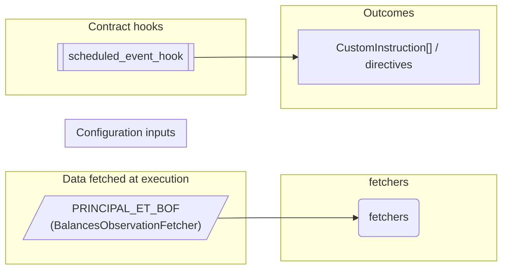
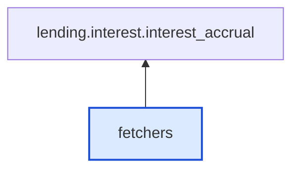

# Fetchers

> Generated by `python3 -m fl docs`. Curated prose comes from `feature_library/src/feature_library/lending/fetchers.okf.yaml`; everything else is derived from the module source. Do not edit by hand.

| Property | Value |
|---|---|
| Module | `feature_library.lending.fetchers` |
| Domain | lending |
| Status | undeclared |
| Version | — |
| Hooks | — |
| Source | `feature_library/src/feature_library/lending/fetchers.py` |

## What it does

_Not yet described._

## Traceability: configuration to outcome

Every input below is a value a bank configures. The diagram shows which function consumes it and which hook turns it into an outcome.

## Inputs — data fetched at execution

| Fetcher id | Type | Anchor | Filter |
|---|---|---|---|
| `PRINCIPAL_ET_BOF` | BalancesObservationFetcher | DefinedDateTime.EFFECTIVE_DATETIME | — |

## Where it sits in the library

## Requirement traceability

_No business requirement is linked to this feature yet, so it cannot be traced back to a stated need._

## Products using it

_None. A feature that no product composes is not yet a proven building block._

## Testing

| Tier | Status | Test modules |
|---|---|---|
| Unit | **missing** | 0 |
| Simulation | yes | 1 |
| End-to-end | yes | 1 |

<!-- generated:end -->
