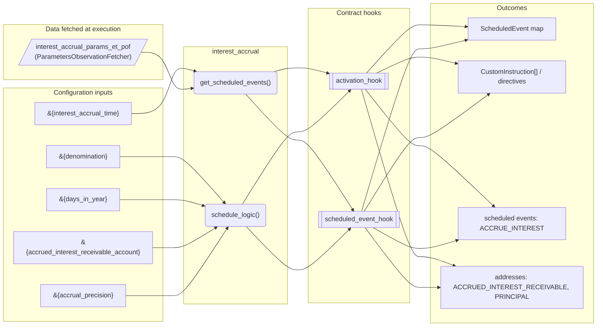

# Interest Accrual

> Generated by `python3 -m fl docs`. Curated prose comes from `feature_library/src/feature_library/lending/interest/interest_accrual.okf.yaml`; everything else is derived from the module source. Do not edit by hand.

| Property | Value |
|---|---|
| Module | `feature_library.lending.interest.interest_accrual` |
| Domain | lending |
| Status | undeclared |
| Version | — |
| Hooks | `activation_hook`, `scheduled_event_hook` |
| Source | `feature_library/src/feature_library/lending/interest/interest_accrual.py` |

## What it does

Interest accrual feature.

## Traceability: configuration to outcome

Every input below is a value a bank configures. The diagram shows which function consumes it and which hook turns it into an outcome.

## Inputs — parameters

| Reference | Meaning | Hierarchy level | Constraint | Required | CLU resource |
|---|---|---|---|---|---|
| `&{accrued_interest_receivable_account}` | _undocumented_ | — | account_constraint | required | `feature_library/src/feature_library/deposit/interest/parameter_resource_defs/accrued_interest_receivable_account.resource.yaml` |
| `&{days_in_year}` | _undocumented_ | — | enumeration_constraint | required | `feature_library/src/feature_library/lending/interest/parameter_resource_defs/days_in_year.resource.yaml` |
| `&{accrual_precision}` | _undocumented_ | — | decimal_constraint | required | `feature_library/src/feature_library/deposit/interest/parameter_resource_defs/accrual_precision.resource.yaml` |
| `&{interest_accrual_time}` | _undocumented_ | — | string_constraint | required | `feature_library/src/feature_library/deposit/interest/parameter_resource_defs/interest_accrual_time.resource.yaml` |
| `&{denomination}` | _undocumented_ | — | string_constraint | required | `feature_library/src/feature_library/common/parameter_resource_defs/denomination.resource.yaml` |

## Inputs — data fetched at execution

| Fetcher id | Type | Anchor | Filter |
|---|---|---|---|
| `interest_accrual_params_et_pof` | ParametersObservationFetcher | DefinedDateTime.EFFECTIVE_DATETIME | ParametersFilter(parameter_ids=[p.id for p in expected_parameters]) |

## Public API

| Function | Returns | Purpose |
|---|---|---|
| `get_scheduled_events(state, fetchers_config)` | `dict[str, ScheduledEvent]` | Get scheduled event for interest accrual. |
| `schedule_logic(state, get_annual_interest_rate, account_type, principal_addresses, customer_accrual_address, fetchers_config, event)` | `list[CustomInstruction]` | Schedule logic for handling interest accrual. |

## Outputs

| Kind | Values | Notes |
|---|---|---|
| Scheduled events | `ACCRUE_INTEREST` | static |
| Balance addresses | `ACCRUED_INTEREST_RECEIVABLE`, `PRINCIPAL` | — |

## Where it sits in the library

```mermaid
graph BT
  me_interest_accrual["interest_accrual"]:::self
  dep_common_accrual_utils["common.accrual_utils"] --> me_interest_accrual
  dep_common_balance_utils["common.balance_utils"] --> me_interest_accrual
  dep_common_date_and_time["common.date_and_time"] --> me_interest_accrual
  dep_common_denomination["common.denomination"] --> me_interest_accrual
  dep_common_parameter_utils["common.parameter_utils"] --> me_interest_accrual
  dep_common_posting_utils["common.posting_utils"] --> me_interest_accrual
  dep_common_state_utils["common.state_utils"] --> me_interest_accrual
  dep_common_utils["common.utils"] --> me_interest_accrual
  dep_lending_addresses["lending.addresses"] --> me_interest_accrual
  dep_lending_fetchers["lending.fetchers"] --> me_interest_accrual
  me_interest_accrual --> use_lending_interest_interest_application["lending.interest.interest_application"]
  me_interest_accrual --> use_lending_interest_secondary_variable_rate["lending.interest.secondary.variable_rate"]
  me_interest_accrual ==> prod_mortgage["mortgage"]:::product
  classDef self fill:#dbeafe,stroke:#1d4ed8,stroke-width:2px;
  classDef product fill:#dcfce7,stroke:#15803d,stroke-width:2px;
```

## Requirement traceability

_No business requirement is linked to this feature yet, so it cannot be traced back to a stated need._

## Products using it

- `mortgage`

## Testing

| Tier | Status | Test modules |
|---|---|---|
| Unit | yes | 1 |
| Simulation | yes | 2 |
| End-to-end | yes | 2 |

<!-- generated:end -->
