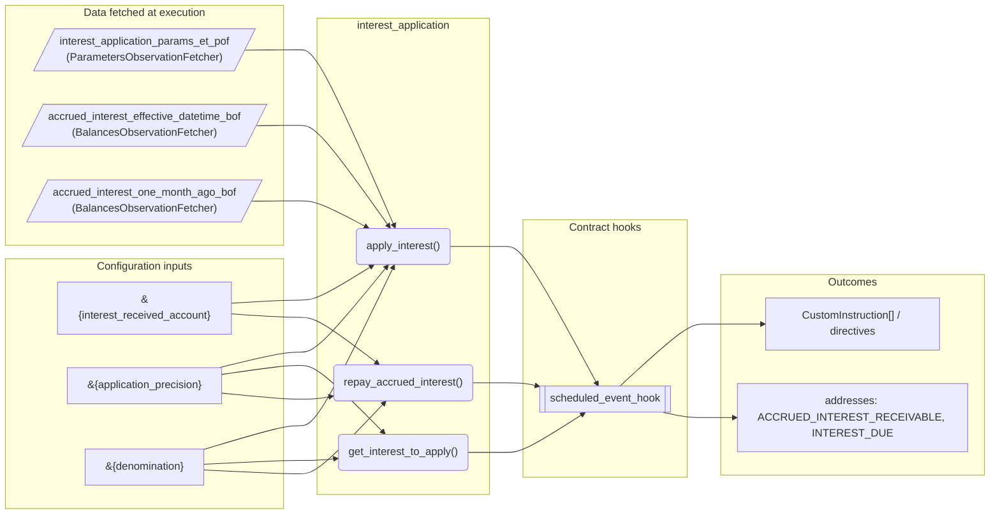

# Interest Application

> Generated by `python3 -m fl docs`. Curated prose comes from `feature_library/src/feature_library/lending/interest/interest_application.okf.yaml`; everything else is derived from the module source. Do not edit by hand.

| Property | Value |
|---|---|
| Module | `feature_library.lending.interest.interest_application` |
| Domain | lending |
| Status | undeclared |
| Version | — |
| Hooks | `scheduled_event_hook` |
| Source | `feature_library/src/feature_library/lending/interest/interest_application.py` |

## What it does

_Not yet described._

## Traceability: configuration to outcome

Every input below is a value a bank configures. The diagram shows which function consumes it and which hook turns it into an outcome.

## Inputs — parameters

| Reference | Meaning | Hierarchy level | Constraint | Required | CLU resource |
|---|---|---|---|---|---|
| `&{interest_received_account}` | _undocumented_ | — | account_constraint | required | `feature_library/src/feature_library/deposit/interest/parameter_resource_defs/interest_received_account.resource.yaml` |
| `&{application_precision}` | _undocumented_ | — | decimal_constraint | required | `feature_library/src/feature_library/common/parameter_resource_defs/application_precision.resource.yaml` |
| `&{denomination}` | _undocumented_ | — | string_constraint | required | `feature_library/src/feature_library/common/parameter_resource_defs/denomination.resource.yaml` |

## Inputs — data fetched at execution

| Fetcher id | Type | Anchor | Filter |
|---|---|---|---|
| `interest_application_params_et_pof` | ParametersObservationFetcher | DefinedDateTime.EFFECTIVE_DATETIME | ParametersFilter(parameter_ids=[p.id for p in expected_parameters]) |
| `accrued_interest_effective_datetime_bof` | BalancesObservationFetcher | DefinedDateTime.EFFECTIVE_DATETIME | BalancesFilter(addresses=[lending_addresses.ACCRUED_INTEREST_RECEIVABLE]) |
| `accrued_interest_one_month_ago_bof` | BalancesObservationFetcher | RelativeDateTime(origin=DefinedDateTime.EFFECTIVE_DATETIME, shift=Shift(months=-1)) | BalancesFilter(addresses=[lending_addresses.ACCRUED_INTEREST_RECEIVABLE]) |

## Public API

| Function | Returns | Purpose |
|---|---|---|
| `apply_interest(state, previous_application_datetime, fetchers_config)` | `list[Posting]` | Creates postings to apply accrued interest. |
| `get_interest_to_apply(state, previous_application_datetime, fetchers_config)` | `lending_interfaces.InterestAmounts` | Determine interest amounts for application, handling EIA/non-EIA considerations. |
| `repay_accrued_interest(state, repayment_amount, application_customer_address, fetchers_config)` | `list[Posting]` | Creates postings to repay accrued interest. |

## Outputs

| Kind | Values | Notes |
|---|---|---|
| Balance addresses | `ACCRUED_INTEREST_RECEIVABLE`, `INTEREST_DUE` | — |

## Composition points

| Provides interface | As constant | Members |
|---|---|---|
| `InterestApplication` | `InterestApplication` | `apply_interest`, `get_interest_to_apply` |

## Where it sits in the library

```mermaid
graph BT
  me_interest_application["interest_application"]:::self
  dep_common_accrual_utils["common.accrual_utils"] --> me_interest_application
  dep_common_application_precision["common.application_precision"] --> me_interest_application
  dep_common_balance_utils["common.balance_utils"] --> me_interest_application
  dep_common_denomination["common.denomination"] --> me_interest_application
  dep_common_state_utils["common.state_utils"] --> me_interest_application
  dep_common_utils["common.utils"] --> me_interest_application
  dep_lending_addresses["lending.addresses"] --> me_interest_application
  dep_lending_interest_interest_accrual["lending.interest.interest_accrual"] --> me_interest_application
  dep_lending_interfaces["lending.interfaces"] --> me_interest_application
  me_interest_application --> use_lending_amortisations_amortisation_methods_flat_interest["lending.amortisations.amortisation_methods.flat_interest"]
  me_interest_application --> use_lending_amortisations_amortisation_methods_rule_of_78["lending.amortisations.amortisation_methods.rule_of_78"]
  me_interest_application ==> prod_mortgage["mortgage"]:::product
  classDef self fill:#dbeafe,stroke:#1d4ed8,stroke-width:2px;
  classDef product fill:#dcfce7,stroke:#15803d,stroke-width:2px;
```

## Requirement traceability

_No business requirement is linked to this feature yet, so it cannot be traced back to a stated need._

## Products using it

- `mortgage`

## Testing

| Tier | Status | Test modules |
|---|---|---|
| Unit | yes | 2 |
| Simulation | yes | 1 |
| End-to-end | yes | 1 |

<!-- generated:end -->
