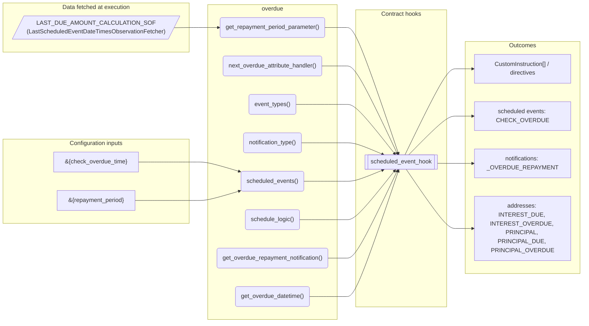
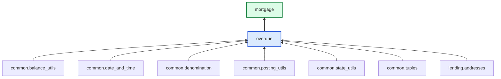

# Overdue

> Generated by `python3 -m fl docs`. Curated prose comes from `feature_library/src/feature_library/lending/overdue/overdue.okf.yaml`; everything else is derived from the module source. Do not edit by hand.

| Property | Value |
|---|---|
| Module | `feature_library.lending.overdue.overdue` |
| Domain | lending |
| Status | undeclared |
| Version | — |
| Hooks | `scheduled_event_hook` |
| Source | `feature_library/src/feature_library/lending/overdue/overdue.py` |

## What it does

_Not yet described._

## Traceability: configuration to outcome

Every input below is a value a bank configures. The diagram shows which function consumes it and which hook turns it into an outcome.

## Inputs — parameters

| Reference | Meaning | Hierarchy level | Constraint | Required | CLU resource |
|---|---|---|---|---|---|
| `&{repayment_period}` | _undocumented_ | — | decimal_constraint | required | `feature_library/src/feature_library/lending/overdue/parameter_resource_defs/repayment_period.resource.yaml` |
| `&{check_overdue_time}` | _undocumented_ | — | string_constraint | required | `feature_library/src/feature_library/lending/overdue/parameter_resource_defs/check_overdue_time.resource.yaml` |

## Inputs — data fetched at execution

| Fetcher id | Type | Anchor | Filter |
|---|---|---|---|
| `LAST_DUE_AMOUNT_CALCULATION_SOF` | LastScheduledEventDateTimesObservationFetcher | DefinedDateTime.EFFECTIVE_DATETIME | EventTypesFilter(event_types=[DUE_AMOUNT_CALCULATION_EVENT]) |

## Public API

| Function | Returns | Purpose |
|---|---|---|
| `get_repayment_period_parameter(state, param_id)` | `int` | Retrieve the repayment period parameter. |
| `next_overdue_attribute_handler(state, hook_arguments, fetchers_config)` | `AttributeHookResult` | Calculate the next overdue attribute. |
| `event_types(product_name)` | `list[SmartContractEventType]` | Return the event types for checking overdue amounts. |
| `notification_type(product_name)` | `str` | Create the notification type. |
| `scheduled_events(state, first_due_amount_calculation_datetime, is_one_off, skip, fetchers_config)` | `dict[str, ScheduledEvent]` | Create a check overdue schedule. |
| `schedule_logic(state, hook_arguments, account_type, late_repayment_fee, fetchers_config)` | `common_tuples.ScheduleLogicResult` | Create postings to credit principal or interest due amounts and debit overdue. |
| `get_overdue_repayment_notification(account_id, product_name, effective_datetime, overdue_principal_amount, overdue_interest_amount, late_repayment_fee)` | `list[AccountNotificationDirective]` | Instruct overdue repayment notification. |
| `get_overdue_datetime(due_amount_notification_datetime, repayment_period, notification_period)` | `datetime` | Return the overdue datetime given the due amount notification date. |

## Outputs

| Kind | Values | Notes |
|---|---|---|
| Scheduled events | `CHECK_OVERDUE` | per-product factory |
| Notifications | `_OVERDUE_REPAYMENT` | — |
| Balance addresses | `INTEREST_DUE`, `INTEREST_OVERDUE`, `PRINCIPAL`, `PRINCIPAL_DUE`, `PRINCIPAL_OVERDUE` | — |

## Where it sits in the library

## Requirement traceability

_No business requirement is linked to this feature yet, so it cannot be traced back to a stated need._

## Products using it

- `mortgage`

## Testing

| Tier | Status | Test modules |
|---|---|---|
| Unit | yes | 1 |
| Simulation | **missing** | 0 |
| End-to-end | **missing** | 0 |

<!-- generated:end -->
