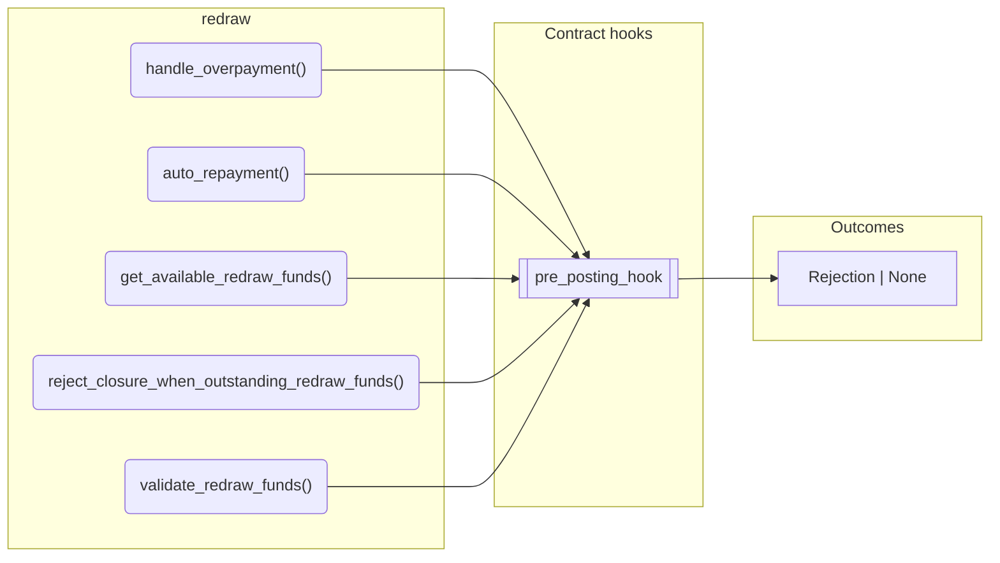
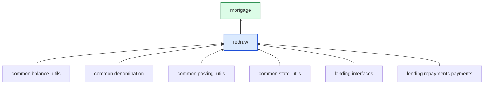

# Redraw

> Generated by `python3 -m fl docs`. Curated prose comes from `feature_library/src/feature_library/lending/redraw/redraw.okf.yaml`; everything else is derived from the module source. Do not edit by hand.

| Property | Value |
|---|---|
| Module | `feature_library.lending.redraw.redraw` |
| Domain | lending |
| Status | undeclared |
| Version | — |
| Hooks | `pre_posting_hook` |
| Source | `feature_library/src/feature_library/lending/redraw/redraw.py` |

## What it does

_Not yet described._

## Traceability: configuration to outcome

Every input below is a value a bank configures. The diagram shows which function consumes it and which hook turns it into an outcome.

## Public API

| Function | Returns | Purpose |
|---|---|---|
| `handle_overpayment(state, overpayment_amount, fetchers_config)` | `list[Posting]` | Handle overpayments by rebalancing the amount to the REDRAW address. |
| `auto_repayment(state, due_amount_posting_instructions, repayment_hierarchy, redraw_address, fetchers_config)` | `list[CustomInstruction]` | Create posting instructions to automatically repay due balances from the redraw balance. |
| `get_available_redraw_funds(state, fetchers_config)` | `Decimal` | Return the available redraw amount. |
| `reject_closure_when_outstanding_redraw_funds(state)` | `Rejection \| None` | Return a rejection if the redraw balance still contains funds. |
| `validate_redraw_funds(state, posting_amount, fetchers_config)` | `Rejection \| None` | Reject a posting if the withdrawal amount is greater than the current redraw balance. |

## Composition points

| Provides interface | As constant | Members |
|---|---|---|
| `Overpayment` | `OverpaymentFeature` | `handle_overpayment` |

## Where it sits in the library

## Requirement traceability

_No business requirement is linked to this feature yet, so it cannot be traced back to a stated need._

## Products using it

- `mortgage`

## Testing

| Tier | Status | Test modules |
|---|---|---|
| Unit | yes | 1 |
| Simulation | **missing** | 0 |
| End-to-end | **missing** | 0 |

<!-- generated:end -->
