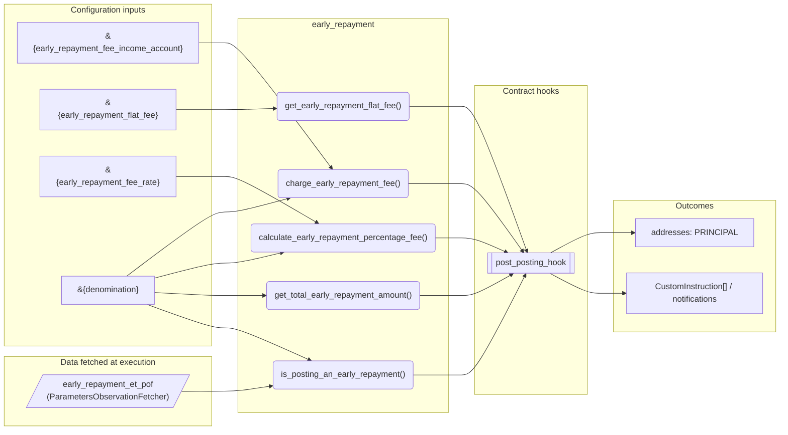
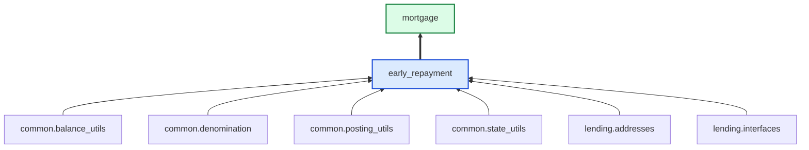

# Early Repayment

> Generated by `python3 -m fl docs`. Curated prose comes from `feature_library/src/feature_library/lending/repayments/early_repayment.okf.yaml`; everything else is derived from the module source. Do not edit by hand.

| Property | Value |
|---|---|
| Module | `feature_library.lending.repayments.early_repayment` |
| Domain | lending |
| Status | undeclared |
| Version | — |
| Hooks | `post_posting_hook` |
| Source | `feature_library/src/feature_library/lending/repayments/early_repayment.py` |

## What it does

_Not yet described._

## Traceability: configuration to outcome

Every input below is a value a bank configures. The diagram shows which function consumes it and which hook turns it into an outcome.

## Inputs — parameters

| Reference | Meaning | Hierarchy level | Constraint | Required | CLU resource |
|---|---|---|---|---|---|
| `&{early_repayment_fee_income_account}` | _undocumented_ | — | account_constraint | required | `feature_library/src/feature_library/lending/repayments/parameter_resource_defs/early_repayment_fee_income_account.resource.yaml` |
| `&{early_repayment_flat_fee}` | _undocumented_ | — | decimal_constraint | required | `feature_library/src/feature_library/lending/repayments/parameter_resource_defs/early_repayment_flat_fee.resource.yaml` |
| `&{early_repayment_fee_rate}` | _undocumented_ | — | decimal_constraint | required | `feature_library/src/feature_library/lending/repayments/parameter_resource_defs/early_repayment_fee_rate.resource.yaml` |
| `&{denomination}` | _undocumented_ | — | string_constraint | required | `feature_library/src/feature_library/common/parameter_resource_defs/denomination.resource.yaml` |

## Inputs — data fetched at execution

| Fetcher id | Type | Anchor | Filter |
|---|---|---|---|
| `early_repayment_et_pof` | ParametersObservationFetcher | DefinedDateTime.EFFECTIVE_DATETIME | ParametersFilter(parameter_ids=[p.id for p in expected_parameters]) |

## Public API

| Function | Returns | Purpose |
|---|---|---|
| `get_parameters(vault, param_fetcher_id)` | `dict[str, datetime \| Decimal \| str \| None]` | Retrieves configuration parameters for the early repayment feature. |
| `is_posting_an_early_repayment(state, repayment_amount, repayment_hierarchy_config, early_repayment_fees, precision, fetchers_config)` | `bool` | Determines if the repayment amount is for a full early repayment. |
| `get_total_early_repayment_amount(state, repayment_hierarchy_config, early_repayment_fees, precision, check_for_outstanding_accrued_interest_on_zero_principal, fetchers_config)` | `Decimal` | Get the exact repayment amount required for a full early repayment. |
| `get_early_repayment_flat_fee(state, precision, fetchers_config)` | `Decimal` | Get the early repayment flat fee amount from the parameter value. |
| `calculate_early_repayment_percentage_fee(state, precision, fetchers_config)` | `Decimal` | Calculates the early repayment fee using the rate from the parameter. |
| `charge_early_repayment_fee(state, amount_to_charge, fee_name, fetchers_config)` | `list[CustomInstruction]` | Handles the early repayment fee within post-posting. |

## Outputs

| Kind | Values | Notes |
|---|---|---|
| Balance addresses | `PRINCIPAL` | — |

## Composition points

| Provides interface | As constant | Members |
|---|---|---|
| `EarlyRepaymentFee` | `EarlyRepaymentFlatFee` | `get_early_repayment_fee_amount`, `charge_early_repayment_fee`, `fee_name` |
| `EarlyRepaymentFee` | `EarlyRepaymentPercentageFee` | `get_early_repayment_fee_amount`, `charge_early_repayment_fee`, `fee_name` |

Accepts: `EarlyRepaymentFee`, `RepaymentHierarchyConfig`

## Where it sits in the library

## Requirement traceability

_No business requirement is linked to this feature yet, so it cannot be traced back to a stated need._

## Products using it

- `mortgage`

## Testing

| Tier | Status | Test modules |
|---|---|---|
| Unit | yes | 1 |
| Simulation | yes | 2 |
| End-to-end | yes | 1 |

<!-- generated:end -->
