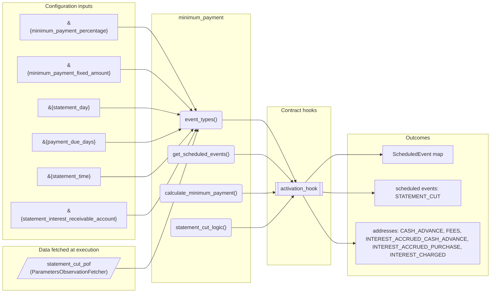
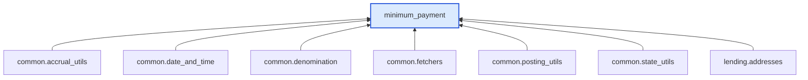

# Minimum Payment

> Generated by `python3 -m fl docs`. Curated prose comes from `feature_library/src/feature_library/lending/repayments/minimum_payment.okf.yaml`; everything else is derived from the module source. Do not edit by hand.

| Property | Value |
|---|---|
| Module | `feature_library.lending.repayments.minimum_payment` |
| Domain | lending |
| Status | undeclared |
| Version | — |
| Hooks | `activation_hook` |
| Source | `feature_library/src/feature_library/lending/repayments/minimum_payment.py` |

## What it does

_Not yet described._

## Traceability: configuration to outcome

Every input below is a value a bank configures. The diagram shows which function consumes it and which hook turns it into an outcome.

## Inputs — parameters

| Reference | Meaning | Hierarchy level | Constraint | Required | CLU resource |
|---|---|---|---|---|---|
| `&{minimum_payment_percentage}` | Minimum payment as a percentage of total balance (e.g. 0.02 for 2%). | — | decimal_constraint | required | `feature_library/src/feature_library/lending/repayments/parameter_resource_defs/minimum_payment_percentage.resource.yaml` |
| `&{minimum_payment_fixed_amount}` | Fixed minimum payment amount. | — | decimal_constraint | required | `feature_library/src/feature_library/lending/repayments/parameter_resource_defs/minimum_payment_fixed_amount.resource.yaml` |
| `&{statement_day}` | Day of month for statement cut. | — | decimal_constraint | required | `feature_library/src/feature_library/lending/repayments/parameter_resource_defs/statement_day.resource.yaml` |
| `&{payment_due_days}` | Number of days after statement cut that payment is due. | — | decimal_constraint | required | `feature_library/src/feature_library/lending/repayments/parameter_resource_defs/payment_due_days.resource.yaml` |
| `&{statement_time}` | Time of day for statement cut. Format: HH:MM:SS. | — | string_constraint | required | `feature_library/src/feature_library/lending/repayments/parameter_resource_defs/statement_time.resource.yaml` |
| `&{statement_interest_receivable_account}` | Internal account for interest receivable used at statement cut. | — | account_constraint | required | `feature_library/src/feature_library/lending/repayments/parameter_resource_defs/statement_interest_receivable_account.resource.yaml` |

## Inputs — data fetched at execution

| Fetcher id | Type | Anchor | Filter |
|---|---|---|---|
| `statement_cut_pof` | ParametersObservationFetcher | DefinedDateTime.EFFECTIVE_DATETIME | ParametersFilter(parameter_ids=[p.id for p in expected_parameters]) |

## Public API

| Function | Returns | Purpose |
|---|---|---|
| `event_types(product_name)` | `list[SmartContractEventType]` | Return the event types for the statement cut feature. |
| `get_parameters(vault, param_fetcher_id)` | `dict[str, datetime \| Decimal \| str \| None]` | Retrieves configuration parameters for the statement cut feature. |
| `get_scheduled_events(state, fetchers_config)` | `dict[str, ScheduledEvent]` | Get scheduled event for monthly statement cut. |
| `calculate_minimum_payment(total_balance, accrued_interest, fees, percentage, fixed_amount)` | `Decimal` | Calculates the minimum payment due. |
| `statement_cut_logic(state, account_type, fetchers_config)` | `list[CustomInstruction]` | Performs statement cut logic. |

## Outputs

| Kind | Values | Notes |
|---|---|---|
| Scheduled events | `STATEMENT_CUT` | per-product factory |
| Balance addresses | `CASH_ADVANCE`, `FEES`, `INTEREST_ACCRUED_CASH_ADVANCE`, `INTEREST_ACCRUED_PURCHASE`, `INTEREST_CHARGED`, `MINIMUM_PAYMENT_DUE_TRACKER`, `PURCHASE`, `STATEMENT_BALANCE_TRACKER`, `TOTAL_REPAYMENTS_TRACKER` | — |

## Where it sits in the library

## Requirement traceability

_No business requirement is linked to this feature yet, so it cannot be traced back to a stated need._

## Products using it

_None. A feature that no product composes is not yet a proven building block._

## Testing

| Tier | Status | Test modules |
|---|---|---|
| Unit | yes | 1 |
| Simulation | **missing** | 0 |
| End-to-end | **missing** | 0 |

<!-- generated:end -->
