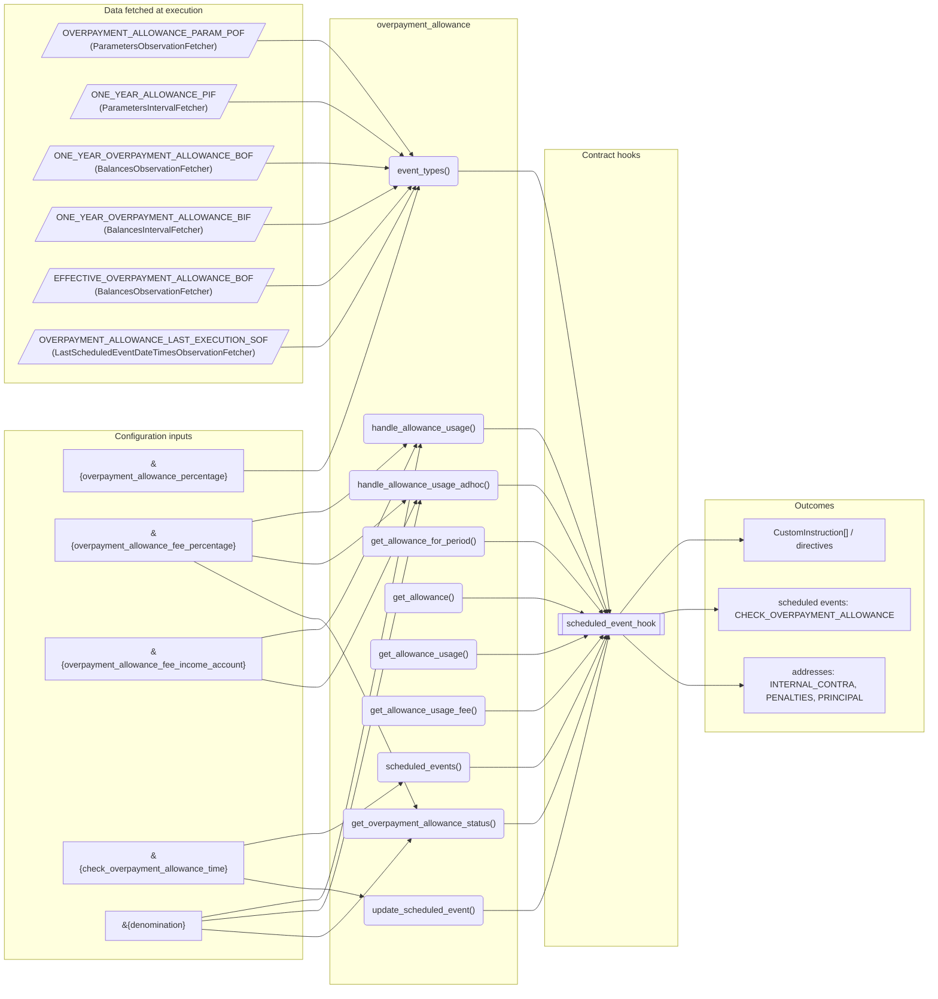

# Overpayment Allowance

> Generated by `python3 -m fl docs`. Curated prose comes from `feature_library/src/feature_library/lending/repayments/overpayment_allowance.okf.yaml`; everything else is derived from the module source. Do not edit by hand.

| Property | Value |
|---|---|
| Module | `feature_library.lending.repayments.overpayment_allowance` |
| Domain | lending |
| Status | undeclared |
| Version | — |
| Hooks | — |
| Source | `feature_library/src/feature_library/lending/repayments/overpayment_allowance.py` |

## What it does

_Not yet described._

## Traceability: configuration to outcome

Every input below is a value a bank configures. The diagram shows which function consumes it and which hook turns it into an outcome.

## Inputs — parameters

| Reference | Meaning | Hierarchy level | Constraint | Required | CLU resource |
|---|---|---|---|---|---|
| `&{overpayment_allowance_percentage}` | _undocumented_ | — | decimal_constraint | required | `feature_library/src/feature_library/lending/repayments/parameter_resource_defs/overpayment_allowance_percentage.resource.yaml` |
| `&{overpayment_allowance_fee_percentage}` | _undocumented_ | — | decimal_constraint | required | `feature_library/src/feature_library/lending/repayments/parameter_resource_defs/overpayment_allowance_fee_percentage.resource.yaml` |
| `&{overpayment_allowance_fee_income_account}` | _undocumented_ | — | account_constraint | required | `feature_library/src/feature_library/lending/repayments/parameter_resource_defs/overpayment_allowance_fee_income_account.resource.yaml` |
| `&{check_overpayment_allowance_time}` | _undocumented_ | — | string_constraint | required | `feature_library/src/feature_library/lending/repayments/parameter_resource_defs/check_overpayment_allowance_time.resource.yaml` |
| `&{denomination}` | _undocumented_ | — | string_constraint | required | `feature_library/src/feature_library/common/parameter_resource_defs/denomination.resource.yaml` |

## Inputs — data fetched at execution

| Fetcher id | Type | Anchor | Filter |
|---|---|---|---|
| `OVERPAYMENT_ALLOWANCE_PARAM_POF` | ParametersObservationFetcher | DefinedDateTime.EFFECTIVE_DATETIME | ParametersFilter(parameter_ids=[p.id for p in expected_parameters]) |
| `ONE_YEAR_ALLOWANCE_PIF` | ParametersIntervalFetcher | RelativeDateTime(origin=DefinedDateTime.EFFECTIVE_DATETIME, shift=Shift(years=-1)) | ParametersFilter(parameter_ids=[OVERPAYMENT_ALLOWANCE_PERCENTAGE_PARAM_ID, OVERP |
| `ONE_YEAR_OVERPAYMENT_ALLOWANCE_BOF` | BalancesObservationFetcher | RelativeDateTime(origin=DefinedDateTime.EFFECTIVE_DATETIME, shift=Shift(years=-1), find=Override(hour=0, minute=0, second=0)) | BalancesFilter(addresses=[overpayment.OVERPAYMENT_ADDRESS, lending_addresses.PRI |
| `ONE_YEAR_OVERPAYMENT_ALLOWANCE_BIF` | BalancesIntervalFetcher | RelativeDateTime(origin=DefinedDateTime.EFFECTIVE_DATETIME, shift=Shift(years=-1)) | BalancesFilter(addresses=[overpayment.OVERPAYMENT_ADDRESS, lending_addresses.PRI |
| `EFFECTIVE_OVERPAYMENT_ALLOWANCE_BOF` | BalancesObservationFetcher | RelativeDateTime(origin=DefinedDateTime.EFFECTIVE_DATETIME, find=Override(hour=0, minute=0, second=0)) | BalancesFilter(addresses=[REMAINING_OVERPAYMENT_ALLOWANCE_TRACKER, lending_addre |
| `OVERPAYMENT_ALLOWANCE_LAST_EXECUTION_SOF` | LastScheduledEventDateTimesObservationFetcher | DefinedDateTime.EFFECTIVE_DATETIME | EventTypesFilter(event_types=[CHECK_OVERPAYMENT_ALLOWANCE_EVENT]) |

## Public API

| Function | Returns | Purpose |
|---|---|---|
| `get_parameters(vault, param_fetcher_id)` | `dict[str, str \| Decimal \| datetime \| None]` | Retrieves configuration parameters for the overpayment feature from the vault. |
| `event_types(account_type)` | `list[SmartContractEventType]` | Return the event types for the overpayment allowance schedule. |
| `scheduled_events(state, allowance_period_start_datetime, fetchers_config)` | `dict[str, ScheduledEvent]` | Create scheduled event to check the overpayment allowance on account opening anniversary. |
| `update_scheduled_event(state, effective_datetime, fetchers_config)` | `dict[str, ScheduledEvent]` | Re-anchor the schedule event to check the overpayment allowance. |
| `get_allowance_for_period(start_of_period_balances, allowance_percentage, denomination, principal_address)` | `Decimal` | Determine the allowance for the period. |
| `get_allowance(principal, allowance_percentage)` | `Decimal` | Determine the allowance for a given principal. |
| `get_allowance_usage(start_of_period_balances, end_of_period_balances, denomination, overpayment_address)` | `Decimal` | Determine the allowance usage over the allowance period. |
| `get_allowance_usage_fee(allowance, used_allowance, overpayment_allowance_fee_percentage)` | `Decimal` | Determine the fee amount to charge. |
| `handle_allowance_usage(state, account_type, fetchers_config)` | `list[CustomInstruction]` | Check the overpayments in the past year and charges a fee if the total exceeds the allowance. |
| `handle_allowance_usage_adhoc(state, account_type, effective_datetime, fetchers_config)` | `list[CustomInstruction]` | Check the overpayments in the past year and charges a fee if the total exceeds the allowance. |
| `get_overpayment_allowance_status(state, effective_datetime, fetchers_config)` | `OverpaymentAllowanceStatus` | Determine the original and used overpayment allowance for the current allowance period. |
| `get_start_of_current_allowance_period(state, check_overpayment_allowance_last_execution_datetime)` | `datetime` | Determine the start of the allowance period in progress. |
| `set_overpayment_allowance_for_period(current_overpayment_allowance, updated_overpayment_allowance, denomination, account_id, remaining_overpayment_allowance_tracker_address, internal_contra_address)` | `list[CustomInstruction]` | Set the overpayment allowance amount for the current period. |
| `reduce_overpayment_allowance(state, overpayment_amount, balances, fetchers_config)` | `list[Posting]` | Create postings to update the overpayment allowance tracker. |
| `get_overpayment_allowance_fee_for_early_repayment(state, fetchers_config)` | `Decimal` | Calculate the overpayment allowance fee if the total amount on the loan were to be repaid. |
| `initialise_overpayment_allowance_from_principal_amount(state, principal, fetchers_config)` | `list[CustomInstruction]` | Return postings to set the overpayment allowance amount. |
| `get_residual_cleanup_postings(balances, account_id, denomination)` | `list[Posting]` | Return the postings needed to cleanup the overpayment allowance tracker balance. |

## Outputs

| Kind | Values | Notes |
|---|---|---|
| Scheduled events | `CHECK_OVERPAYMENT_ALLOWANCE` | per-product factory |
| Balance addresses | `INTERNAL_CONTRA`, `PENALTIES`, `PRINCIPAL` | — |

## Composition points

| Provides interface | As constant | Members |
|---|---|---|
| `Overpayment` | `OverpaymentAllowanceFeature` | `handle_overpayment` |
| `ResidualCleanup` | `OverpaymentAllowanceResidualCleanupFeature` | `get_residual_cleanup_postings` |

## Where it sits in the library

```mermaid
graph BT
  me_overpayment_allowance["overpayment_allowance"]:::self
  dep_common_addresses["common.addresses"] --> me_overpayment_allowance
  dep_common_balance_utils["common.balance_utils"] --> me_overpayment_allowance
  dep_common_date_and_time["common.date_and_time"] --> me_overpayment_allowance
  dep_common_denomination["common.denomination"] --> me_overpayment_allowance
  dep_common_fees["common.fees"] --> me_overpayment_allowance
  dep_common_posting_utils["common.posting_utils"] --> me_overpayment_allowance
  dep_common_state_utils["common.state_utils"] --> me_overpayment_allowance
  dep_common_utils["common.utils"] --> me_overpayment_allowance
  dep_lending_addresses["lending.addresses"] --> me_overpayment_allowance
  dep_lending_interfaces["lending.interfaces"] --> me_overpayment_allowance
  dep_lending_repayments_overpayment["lending.repayments.overpayment"] --> me_overpayment_allowance
  me_overpayment_allowance ==> prod_mortgage["mortgage"]:::product
  classDef self fill:#dbeafe,stroke:#1d4ed8,stroke-width:2px;
  classDef product fill:#dcfce7,stroke:#15803d,stroke-width:2px;
```

## Requirement traceability

_No business requirement is linked to this feature yet, so it cannot be traced back to a stated need._

## Products using it

- `mortgage`

## Testing

| Tier | Status | Test modules |
|---|---|---|
| Unit | yes | 1 |
| Simulation | yes | 1 |
| End-to-end | **missing** | 0 |

<!-- generated:end -->
