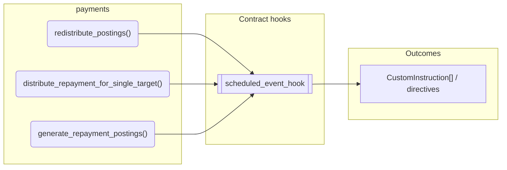
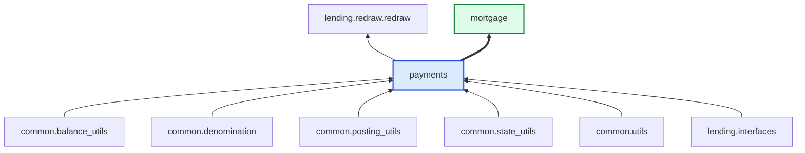

# Payments

> Generated by `python3 -m fl docs`. Curated prose comes from `feature_library/src/feature_library/lending/repayments/payments.okf.yaml`; everything else is derived from the module source. Do not edit by hand.

| Property | Value |
|---|---|
| Module | `feature_library.lending.repayments.payments` |
| Domain | lending |
| Status | undeclared |
| Version | — |
| Hooks | — |
| Source | `feature_library/src/feature_library/lending/repayments/payments.py` |

## What it does

_Not yet described._

## Traceability: configuration to outcome

Every input below is a value a bank configures. The diagram shows which function consumes it and which hook turns it into an outcome.

## Public API

| Function | Returns | Purpose |
|---|---|---|
| `redistribute_postings(debit_account, denomination, amount, credit_account, credit_address, debit_address)` | `list[Posting]` | Redistribute a lump sum of payment into another account / address. |
| `distribute_repayment_for_single_target(balances, repayment_amount, denomination, repayment_hierarchy, phase)` | `RepaymentDistribution` | Determine how a repayment amount is distributed across balances. |
| `generate_repayment_postings(state, hook_arguments, repayment_hierarchy_config, is_posting_early_repayment_callable, handle_penalties_pending_capitalisation_callable, overpayment_features, early_repayment_fees, repay_accrued_interest_callable)` | `list[CustomInstruction]` | Generates the necessary CustomInstructions to process a repayment. |

## Composition points

Accepts: `EarlyRepaymentFee`, `Overpayment`, `RepaymentHierarchyConfig`

## Where it sits in the library

## Requirement traceability

_No business requirement is linked to this feature yet, so it cannot be traced back to a stated need._

## Products using it

- `mortgage`

## Testing

| Tier | Status | Test modules |
|---|---|---|
| Unit | yes | 1 |
| Simulation | yes | 1 |
| End-to-end | **missing** | 0 |

<!-- generated:end -->
